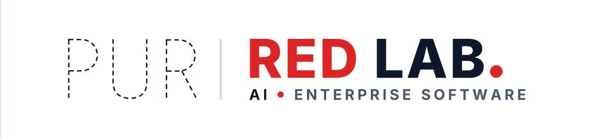

<div align="center">

<picture>
  <source media="(prefers-color-scheme: dark)" srcset="brand/pur_red_lab_opt_a_dark_crop.png">
  <source media="(prefers-color-scheme: light)" srcset="brand/pur_red_lab_opt_a_light_crop.png">
  
</picture>

**Lincă Ovidiu — Software Developer & Enterprise Architect**

18+ years of experience in enterprise systems, fintech, banking and high-traffic platforms.

[](https://www.pur4u.ro)
[](https://www.linkedin.com/in/pur4u)
[](https://github.com/pur4u)

</div>

---

## 👋 About

This repository hosts the website **[www.pur4u.ro](https://www.pur4u.ro)** — the professional profile of Lincă Ovidiu, based in Bucharest, Romania.

Areas of expertise: enterprise backend architecture, high-scale data and cloud infrastructure, AI-enabled workflows and modern frontend development.

## 🛠️ Tech stack

| Area | Stack |
| --- | --- |
| **Backend** | Laravel (14+ years), PHP 8, Node.js, Go, WordPress (8+ years) |
| **Frontend** | TypeScript, React, Vue.js |
| **Data & messaging** | PostgreSQL, MySQL, ClickHouse, Kafka |
| **Cloud & DevOps** | AWS, Kubernetes, Docker |
| **AI** | LLMs, RAG, Ollama, vLLM, MCP, n8n |

## 📁 Project structure

```text
.
├── index.html          # main page
├── assets/             # compiled JS and CSS
├── brand/              # logo and other site assets
├── favicon.*           # site icons
├── site.webmanifest    # web app manifest
├── _headers            # HTTP headers
├── robots.txt          # crawler rules
├── llms.txt            # site description for AI crawlers
├── ads.txt
└── CNAME               # custom domain (www.pur4u.ro; pur4u.ro redirects)
```

## 📬 Contact

- ✉️ [contact@pur4u.ro](mailto:contact@pur4u.ro)
- 📞 [+40.726.519.320](tel:+40726519320)

---

<div align="center">
<sub>© PUR RED LAB · Made in Bucharest 🇷🇴</sub>
</div>
